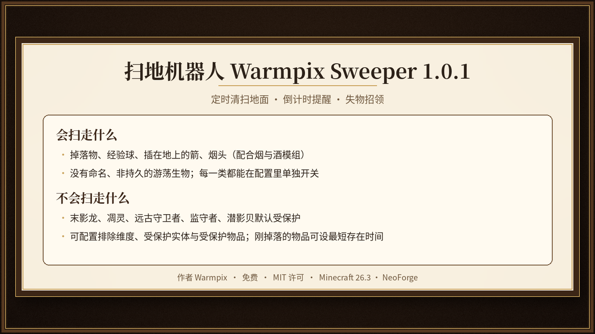
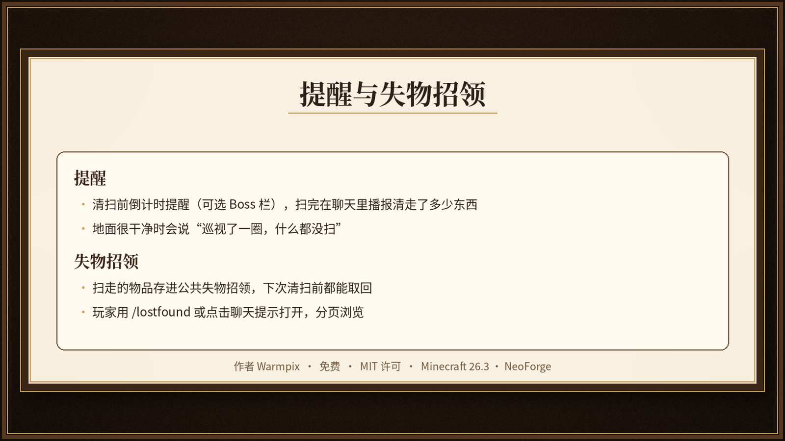
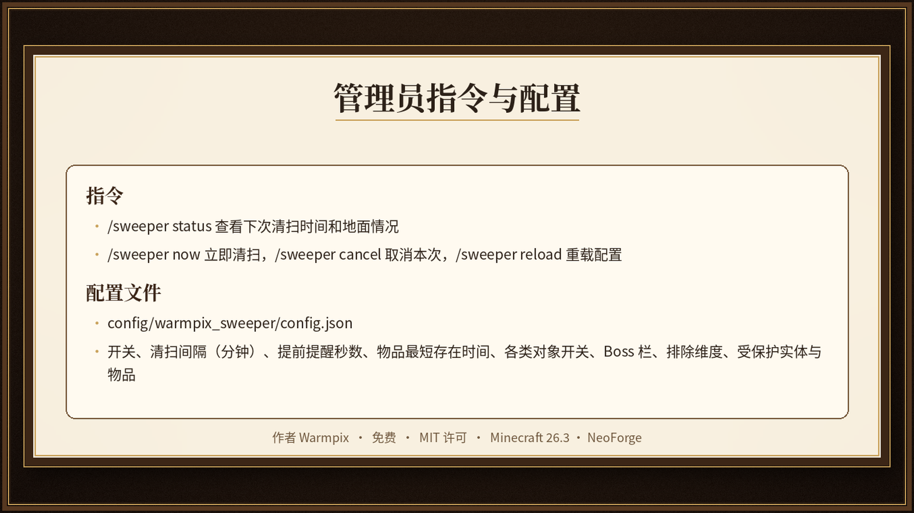

# 扫地机器人 Warmpix Sweeper

定时清扫各世界地面上的掉落物和游荡生物，扫走的物品放进失物招领，下次清扫前都能取回。

- Minecraft：26.3
- 加载器：NeoForge 26.3.0.23-beta 或更高
- 客户端与服务端都需要安装
- 无其他模组前置
- 语言：简体中文 / English

## 截图 Screenshots

## 下载

请到 [Releases](../../releases) 页面下载 jar（版本 1.0.1）。

## 内容

- 定时清扫所有已加载世界：掉落物、经验球、插在地上的箭、烟头（配合烟与酒模组），以及没有命名、非持久的游荡生物
- 清扫前倒计时提醒（可选 Boss 栏），扫完播报清走了多少
- 扫走的物品进入公共失物招领，下次清扫前可取回（/lostfound）
- 末影龙、凋灵、远古守卫者、监守者、潜影贝默认受保护
- 管理员指令：/sweeper status、/sweeper now、/sweeper cancel、/sweeper reload
- 配置文件 config/warmpix_sweeper/config.json：开关、间隔、提醒秒数、物品最短存在时间、各类对象开关、排除维度、受保护实体与物品

## 说明

- 本仓库只用于发布 jar，不含源码。
- jar 只有约 23 KB，没有方块和物品。

作者：Warmpix ｜ 许可：MIT

## 🏡 暖像素 WarmPix 服务器

本模组正在 **暖像素 WarmPix** 服务器上使用，欢迎来服里实际体验。

暖像素 WarmPix 是新开的 Java 26.3 NeoForge 模组生存服，公益服无付费内容，多线、无白名单，正版/离线账号都能进。新服招人开荒，长期稳定运营、永久不跑路。

- 服务器地址：`minecraft.warmpix.com`
- 官网：https://warmpix.com/
- 宣传片：https://www.bilibili.com/video/BV1NhWh6dEcu/
- QQ 群：**705556278**

扫码或搜索群号 705556278 加入 QQ 群。
